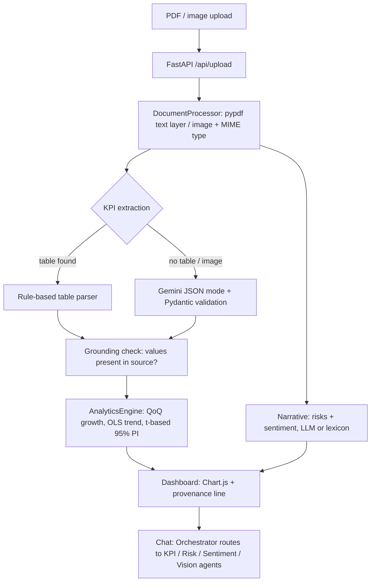

# AlphaDoc-Analytics 📊

A financial document intelligence platform: upload a quarterly earnings PDF (or a chart image), and it
**extracts the KPI table**, **forecasts next quarter with an honest 95% prediction interval**, pulls out
**risk statements and management tone**, and lets you **chat with specialist agents** about the results.

[](https://www.python.org/)
[](https://fastapi.tiangolo.com/)
[-orange.svg)](https://ai.google.dev/)
[](tests/)
[](LICENSE)

---

## Key design idea

**LLMs read, statistics predict.** Language models are good at understanding messy documents and bad at
arithmetic, so the system never asks an LLM to forecast. Numbers are extracted (deterministically where
possible), validated, and then handed to a classical OLS model that reports its own uncertainty.

| Capability | Without API key (offline) | With `GEMINI_API_KEY` |
| --- | --- | --- |
| KPI table extraction (PDF) | Rule-based table parser | Rule-based parser first, LLM fallback for unusual layouts |
| Chart / image documents | Not supported (clear error) | Gemini vision model |
| Risks & sentiment | Keyword extraction + finance lexicon | LLM, validated against a Pydantic schema |
| Forecast | OLS trend + t-based 95% prediction interval | same |
| Chat agents | Template answers from extracted data | LLM answers grounded in extracted data |

Every response includes `extraction_mode`, so the UI always shows **where each number came from** and
what share of the extracted KPI values were found verbatim in the source text (a hallucination check).
The app never shows invented numbers: if nothing can be extracted it returns an error.

---

## Results on real data (reproducible)

The repo ships Tesla's four 2024 quarterly update PDFs (`real_datasets/`). `python backend/evaluate.py` gives:

| Check | Result |
| --- | --- |
| Field-level extraction accuracy (4 reports × 5 quarters × 4 KPIs) | **80/80** vs. hand-checked values |
| Cross-report consistency (same quarter in several reports) | 0 conflicts |
| Revenue backtest, 5 walk-forward forecasts | OLS MAPE **8.6%** vs naive 9.0% |
| Net income backtest | OLS MAPE 168% vs naive 148% (Q4 2023 one-off tax benefit breaks a linear trend) |

Honest reading: the parser is reliable **on this report format**; it has not been tested on many issuers.
With only 8 quarters, the trend model is barely better than "same as last quarter" for revenue and worse for
a series with a one-off spike, which is exactly why the dashboard shows wide prediction intervals and R².

---

## Architecture



### Repository structure

```text
AlphaDoc-Analytics/
├── backend/
│   ├── app.py                    # FastAPI app: /api/upload, /api/demo, /api/chat, /api/health + serves UI
│   ├── evaluate.py               # Extraction accuracy + forecast backtest on the Tesla PDFs
│   ├── download_real_data.py     # Re-downloads the Tesla quarterly PDFs
│   ├── generate_samples.py       # Synthetic sample PDFs for UI testing (fictional numbers)
│   └── pipeline/
│       ├── document_processor.py # PDF text extraction, image encoding + MIME detection
│       ├── table_parser.py       # Deterministic quarterly KPI table parser
│       ├── llm_client.py         # Gemini client (google-genai SDK), configurable model
│       ├── llm_extractor.py      # Hybrid extraction, schema validation, grounding check
│       ├── narrative.py          # Lexicon sentiment, risk sentences, computed insights
│       ├── analytics.py          # Growth rates, OLS forecast, prediction interval, backtest
│       └── agents.py             # Orchestrator + KPI / Risk / Sentiment / Vision agents
├── frontend/                     # Vanilla HTML/CSS/JS dashboard with Chart.js
├── notebooks/eda_and_modeling.ipynb  # EDA, interval maths and backtest on the real data
├── real_datasets/                # Tesla Q1–Q4 2024 quarterly update PDFs
├── tests/                        # pytest: parser, statistics, API
├── docs/                         # Technical write-up and interview guide
├── .env.example
└── requirements.txt
```

---

## Setup

```bash
git clone https://github.com/scodes-byte/AlphaDoc-Analytics.git
cd AlphaDoc-Analytics
pip install -r requirements.txt
cp .env.example .env        # optional: add GEMINI_API_KEY
python run.py               # opens http://127.0.0.1:8000
```

Click **Load Tesla 2024 Demo** to run the full pipeline on the bundled reports (first load parses
~140 PDF pages and takes a few seconds), or upload your own quarterly report.

Other commands:

```bash
python -m pytest -q             # 26 tests (offline, no API key needed)
python backend/evaluate.py      # accuracy + backtest numbers above
```

API docs are at `http://127.0.0.1:8000/docs`.

---

## Limitations & next steps

- Parser handles "label then one number per quarter" tables; multi-row headers or scanned PDFs need the LLM or OCR.
- The document store is in memory and single-user; production would key it by session and persist it.
- OLS on 8 points is a baseline. Next: robust regression (Huber) for one-off items, seasonal models with more history,
  and evaluating extraction across many issuers and layouts.
- Chat routing is keyword-based; an LLM or embedding classifier would route ambiguous questions better.

## License

MIT, see [LICENSE](LICENSE).
